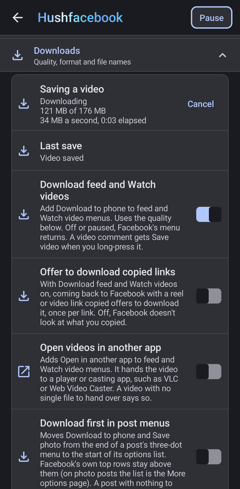

<p align="center">
  <a href="https://github.com/SysAdminDoc/Hushfacebook/releases"></a>
  <a href="LICENSE"></a>
  
  
  
</p>

<p align="center">
  <a href="https://ko-fi.com/X8K126YVER">
    
  </a>
</p>

# Hushfacebook

Hushfacebook is a set of [Morphe](https://morphe.software) patches for the Facebook app on Android. You bring the Facebook APK, Morphe Manager patches it on your phone, and you get a Facebook with a settings screen of its own. Sponsored and suggested posts go away, and so do the ads in Stories, Reels, search and Marketplace. You can save reels, videos, stories and photos, open links in your own browser, hide the Reels tab and send Facebook less about what you do.

Each row in the [patch table](docs/patches.md) says how its switch starts. The ad filters and a handful of others start on, and most of the rest start off until you turn them on. On a computer, [HushFacebook Web](https://github.com/SysAdminDoc/HushFacebookWeb) is a separate userscript for Facebook in the browser.

This project has no connection to Meta or to the Morphe project. Neither endorses it, and neither wrote it.

The latest release is [v0.24.0](https://github.com/SysAdminDoc/Hushfacebook/releases/tag/v0.24.0), with 127 patches. It includes all changes since v0.23.0, among them background play for the next reel, a tab bar that stays in groups, a pause button for feed videos, a proxy you can point Facebook at, a centered feed column on tablets, and the move to Facebook 588.0.0.42.55, as the [changelog](CHANGELOG.md) describes.

[Add to Morphe](https://morphe.software/add-source?github=SysAdminDoc%2FHushfacebook) | [Download a release](https://github.com/SysAdminDoc/Hushfacebook/releases/latest) | [Browse the patches](docs/patches.md)

> [!IMPORTANT]
> Back up your signing key after your first patch. Android only installs an update over your patched Facebook when it's signed with the same key, and without that key you'd have to uninstall, which deletes Facebook's data. [Keep your signing key](#keep-your-signing-key) shows how.

## Install

1. Install [Morphe Manager](https://github.com/MorpheApp/morphe-manager) 2.7.0 or newer.
2. Add Hushfacebook as a patch source: https://morphe.software/add-source?github=SysAdminDoc%2FHushfacebook
3. Download Facebook 588.0.0.42.55 from [APKMirror](https://www.apkmirror.com/apk/facebook-2/facebook/). Take the bundle labelled (arm64-v8a) (120-480dpi) (Android 11+), build 707615136, or on a phone with only a 32-bit processor the one labelled (arm-v7a) (320dpi) (Android 11+), build 707615135. Both are .apkm files. Take the 64-bit one whenever your phone can run it. The 32-bit one only has images for 320 dpi screens, so on a sharper screen some icons look soft.
4. In Morphe Manager, tap **Select other apps**, then **Open APK file**, and pick that file. Android may ask for file access the first time.
5. Patch with the default selection and install. If Meta's own Facebook is on the phone, Android makes you uninstall it first, as [Package conflict](docs/help.md#package-conflict) explains.

The default selection is every patch but five, so you don't need Expert mode. To add `AMOLED black theme`, `Material You theme`, `Disable Play Store updates`, `GmsCore support` (only for phones with microG-RE) or `Clone install under another package name` (a second Facebook), turn on **Settings → Advanced → Expert mode** in Manager before you open the file, then pick them on the **Hushfacebook** tab. If you saved an Expert mode selection before, Manager keeps using it, so tap **Enable recommended patches** once to pick up the patches that joined the default selection since. That unticks the five above, so pick the ones you want again before you patch. Without `AMOLED black theme` dark mode stays Facebook's dark gray, and Hushfacebook's Appearance page says the theme isn't in your build. If you also use another Facebook patch source, check that the two don't patch the same thing ([Patching stops on one patch](docs/help.md#patching-stops-on-one-patch)).

There are Hush patch sources for other apps too: [HushGram](https://github.com/SysAdminDoc/HushGram) for Instagram, [HushMessenger](https://github.com/SysAdminDoc/HushMessenger) for Messenger, [HushPine](https://github.com/SysAdminDoc/HushPine) for PineDrama, [HushPinterest](https://github.com/SysAdminDoc/HushPinterest) for Pinterest, [HushTelegram](https://github.com/SysAdminDoc/HushTelegram) for Telegram, [HushThreads](https://github.com/SysAdminDoc/HushThreads) for Threads, [Hushfeed](https://github.com/SysAdminDoc/HushFeed) for TikTok and [HushTumblr](https://github.com/SysAdminDoc/HushTumblr) for Tumblr. Each one is a separate source in Manager, so add only the ones for apps you patch.

### Keep your signing key

Morphe Manager signs the patched Facebook with a key it makes on your phone, and every update has to carry that same key. Back it up right after your first patch, under **Settings → Backup → Signing key** in Manager, then tap **Export**. The button only shows up once you've patched something. Manager 2.4.0 and newer save it as `Morphe.p12` (older versions saved `Morphe.keystore`). Keep that file somewhere private, because anyone who has it can sign an APK your phone will take as an update. The file opens with the key's own password. A key Manager made itself uses Manager's usual password, which it tries on its own when you import. If you once imported a key with a password of your own, keep that password with the file.

On a new phone, import the key in the same place before you patch anything. Reinstalling Manager or clearing its storage makes a new key, and Morphe's settings backup doesn't include it. With a different key, the only way forward is to uninstall the patched Facebook, which deletes its data. A Root Mount install sits over Meta's own Facebook and doesn't have this problem. Morphe's own guide is [Backup and keystore](https://github.com/MorpheApp/morphe-manager/blob/main/docs/backup-and-keystore.md).

## Settings

<p></p>

There are three ways in. Long-press the Facebook logo at the top of your feed, or the title at the top of another tab like Notifications. Long-press Facebook's icon on your home screen and tap **Hushfacebook** (if it isn't there, open Facebook once and try again, and check **Settings shortcut on the app icon** under Menu is on). Or open Facebook's Menu, expand **Settings and privacy** and tap **Hushfacebook settings** at the end. Each has a switch under Menu in the settings (**Open settings from the logo**, **Settings shortcut on the app icon** and **Settings row in Menu**), and the last one still on stays on, so you can always get back in.

Every section is on the main settings page. Tap a heading to open its controls underneath, then tap it again to collapse them. Several sections can stay open. Search is below the title, and **Pause** is in the top bar. **Support** expands to show Report a problem and Restart Facebook. Search reaches every setting, and you can flip a switch right in the results. Clearing search returns to your open sections and position.

Switches act straight away, with no restart and no new patching, but what's already on screen stays as it was until Facebook draws it again. A reel keeps the buttons it was built with, and rows already in the feed stay until it loads fresh posts. The Stories tray switch shows the next time you pull the feed down to refresh. A row that tells you to restart Facebook, such as the font and tab switches, waits for that restart.

Changing one of those brings up a **Restart Facebook** row at the top of the page. A tap reopens settings with your sections and position restored. You can also restart from **Support** whenever Facebook needs a fresh start. **Report a problem** opens a GitHub bug report with your versions and switches filled in.

**Pause Hushfacebook** turns every switch off from the next start without forgetting your choices. A few things stay in, Lock Facebook among them, and the screen lists them. If Facebook crashes, freezes or gets closed by Android for using too much memory within a minute of starting three times in a row, Hushfacebook pauses itself and the screen says so.

Morphe Manager can back up your patch choices but not these switches. **Export settings** saves them to a JSON file, word lists included, and **Import settings** reads one back on this phone or a new one. It shows what the file would change before anything does. **Reset settings** puts them all back to how a new install has them, and **Undo the reset** brings yours back. **Check for new Hushfacebook releases** under Updates is off until you turn it on. Then it asks GitHub once a day and tells you when there's a newer release, and you update through Morphe Manager as usual.

The settings follow the language Facebook shows. German, Spanish, Indonesian, Italian, Korean, Brazilian Portuguese, Turkish, Vietnamese, Russian, Bulgarian, Thai, Arabic, Simplified Chinese and Traditional Chinese (Taiwan) are translated. Other languages get English. [Translating](CONTRIBUTING.md#translating) explains how to fix a string or add a language.

To keep Reel downloads in More without the sidebar button, leave **Download** on under **Reels and Watch** and turn off **Download button on reels** on the same page.

Turn on **Queue reel saves** there too, and Download on a reel adds it to a queue instead of saving it right away. The queue saves one reel at a time in the background, at the quality picked when you tapped. Its notification counts what's saved, waiting and failed and has Pause and Cancel, and Downloads in the Hushfacebook settings shows the same. A reel that fails gets one more try. It starts off, and the queue is gone once Facebook closes. Hold Download instead of tapping it to save that reel and the ones after it, 10 to 150 at a time. Hushfacebook swipes through them for you and stops when you hold Download again or cancel the queue.

**Cast button on reels**, on the same page, adds a cast button under Download on a reel's sidebar. Like the feed one below, it hands the reel to a casting app you have, and it works with Download off too. It starts off.

**Clean mode button on reels** puts a Clean mode button on that sidebar as well. Tap it and the buttons down the side go away, and they stay away on the next reels until you tap Facebook's own Clean mode button. It starts off, and it shows anyway while **Always use Clean mode** is on, since that's how a reel you took out of Clean mode goes back in.

**Hide WhatsApp on reels**, also under **Reels and Watch**, removes the direct WhatsApp button beside a reel or video. It starts off. WhatsApp stays available in the Share menu.

**Inline feed video controls**, under **Video and audio**, adds a separate play/pause button to feed videos, on Home and in Pages, groups and profiles. It starts off. With **Tap to play** on as well, Facebook's own Autoplay setting stays as you set it so the button can show, and videos still wait for you. Tap the video itself for full screen. Live videos get the button too, though not the seek bar or cast button below, since a live stream has no end to jump around in and no file to hand over. Ads keep their own controls.

**Full player button on feed videos**, right below it, adds a button next to play that opens the video in Facebook's own full player, with all its controls. A video playing in the feed stops first. It starts off, and live videos get it too. With Tap to play on, it needs Inline feed video controls on too. **Full player button by the speaker**, under it, moves that button down to the video's bottom corner and slides Facebook's speaker button over to make room. Live videos and videos without the speaker keep it up top. It starts off.

**Double tap to skip on feed videos**, a little further down, works like a phone's video player. Double tap the right side of a playing feed video to jump ahead 10 seconds, or the left side to go back 10, and keep tapping to go further. Live videos work too when they can be rewound. A single tap on a side still opens the video, just a moment later, since Hushfacebook waits to see whether a second tap follows. Taps in the middle and on buttons go through right away. It starts off, and with Tap to play on it needs Inline feed video controls on too.

**Tap shows a pause button on feed videos**, just below, keeps a tap from throwing a feed video into Reels. The first tap puts a big play/pause button in the middle of the video and the video keeps going. Tap that button to pause or play, or tap the video again while it shows to open it like before. On a playing video the button goes away after a few seconds, and on a paused one it stays put. With double tap to skip on too, a single tap on a side brings up the button after that short wait. It starts off, and with Tap to play on it needs Inline feed video controls on too.

**Seek bar on feed videos**, right below that, runs a thin bar along the bottom of a feed video. Drag it and let go to jump to that point, and the time shows while you drag. It starts off. You won't see it while the video's bottom edge is off screen or covered by the tab bar, or while comments are open, and the same goes for the strip at the very bottom of the screen that Android keeps for its home swipe. Scroll a little and it comes back. With Tap to play on, it needs Inline feed video controls on too. Four switches under it change how it looks. **Fade the seek bar and speaker** dims the bar and Facebook's speaker a few seconds into a playing video, and a touch or a pause brings them back. **Lower the seek bar and speaker** moves the bar down toward the bottom edge, and Facebook's corner buttons come down with it. **Seek bar on the bottom edge** puts the bar right on that edge, out of the way while you scroll, and lifts Facebook's corner buttons above it. It wins over Lower. **Thin line seek bar** goes further and draws the bar as a thin line flush with that edge, like Instagram's, with no dot until you drag it. Live videos get the line too while they can be rewound, and letting go at the far right end takes you back to live. All four start off. **Drag along the bottom edge** keeps the thin line on that edge while you drag it, the way Instagram's does, with the time in the middle instead of a raised bar and bubble. It starts off too. **Times on the seek bar** puts the time so far and the time left at the bar's two ends (on the thin line they sit just above its ends), and **Full length on the seek bar** shows the whole length at the right end in place of the time left. Both start off too.

**Cast button on feed videos**, the last of these, puts a cast button in a feed video's top right corner. Facebook has no casting of its own anymore, so the button hands the video to a casting app you have, like Web Video Caster. It starts off.

**Open full screen videos centered** is for videos that open in Facebook's full screen player, say from a comment or a link. Facebook opens them with the details and comments under the video, which pushes a wide video up to the top of the screen. With this on they start with that panel folded away, so the video sits in the middle. The arrow under the video still brings the panel back. It starts off and applies to the next video you open.

**Seek bar on stories**, under **Stories**, gives a video story a bar along its bottom that you drag to move through it. The story waits while you drag and plays on when you let go. On a video story it sits where **Progress bar at the bottom** draws its line, and that line steps aside for it. Live stories and ads get no bar. **Fade the story seek bar** has its own switch, separate from the feed's, so the story bar only fades if you want it to. Both are off at first.

**Plain slide between people**, also under **Stories**, takes the cube turn out of a swipe from one person's stories to the next, so the pages just slide across. It starts off.

**Hide the Follow button**, under **Stories**, takes Follow off a story from someone you don't follow. **Hide the reply bar** goes further and takes away the whole bar under someone else's story, so the repost button, the Send message box and the quick reactions are gone too. **Hide the Up next card** starts the next stories right away instead of counting down on a card first. They all start off.

### Blocking Reels

Reels turn up in several places, and no one switch covers them all. Searching the settings for "block reels" brings up a map of them.

| Where Reels show up | What blocks them |
|---|---|
| Rows of reels between posts in your feed | **Hide Reels in the feed**, under News feed. |
| Reels and videos that start playing by themselves | **Tap to play**, under Video and audio. |
| The Reels tab in Facebook's tab bar | **Hide the Reels tab**, under Reels and Watch, after a restart. Facebook's own setting works too, under Settings, Tab bar, Customize the bar, then Hide next to Reels. |
| The dot or new count on the Reels tab | **Hide the Reels tab dot**, under Reels and Watch. |
| The "Are you interested in this reel?" prompt, or the survey between reels asking how well a video matches your interests | **Hide reel interest prompts**, under Reels and Watch. |
| Everything except Marketplace | **Marketplace only**, under Opening Facebook. After a restart it keeps Marketplace, Notifications and Profile/Menu and drops the other tabs. |
| Everything except Events | **Events only**, under Opening Facebook. After a restart it keeps Events, Notifications and Profile/Menu and drops the other tabs. Marketplace only wins if both are on. |

## Patches

Every patch has a row in the [patch list](docs/patches.md) that says what it does and whether its switch starts on.

## Help

Questions about setting up, or about whether a Facebook build works, go in [Discussions](https://github.com/SysAdminDoc/Hushfacebook/discussions). For something that's broken, use the [bug form](https://github.com/SysAdminDoc/Hushfacebook/issues/new?template=bug_report.yml) and attach a diagnostic report from Hushfacebook settings. It leaves out links, IDs and the credentials it recognizes, but read it before you share it. If Facebook crashes before you can reach the settings, attach the newest `crash-` file from Download/Hushfacebook instead. The file identifies the Facebook build and the patch bundle that produced it. Ideas go on the [feature form](https://github.com/SysAdminDoc/Hushfacebook/issues/new?template=feature_request.yml). When Morphe Manager misbehaves with every app, not only Facebook, [Morphe's own tracker](https://github.com/MorpheApp/morphe-manager/issues) is the place.

These come up most. Each one has its fix in [Help](docs/help.md).

- [Unsupported Version](docs/help.md#unsupported-version)
- [Patching stops on one patch](docs/help.md#patching-stops-on-one-patch)
- [The log says a patch goes on without something](docs/help.md#the-log-says-a-patch-goes-on-without-something)
- [Unexpected end of ZLIB input stream](docs/help.md#unexpected-end-of-zlib-input-stream)
- [No space left on device](docs/help.md#no-space-left-on-device)
- [Update required](docs/help.md#update-required)
- [Package conflict](docs/help.md#package-conflict)
- [INSTALL_FAILED_DUPLICATE_PERMISSION](docs/help.md#install_failed_duplicate_permission)
- [Android blocks apps from unverified developers](docs/help.md#android-blocks-apps-from-unverified-developers)
- [Facebook links from other apps don't open in Facebook](docs/help.md#facebook-links-from-other-apps-dont-open-in-facebook)
- [A second Facebook beside the first](docs/help.md#a-second-facebook-beside-the-first)
- [Facebook or Google Play offers an update](docs/help.md#facebook-or-google-play-offers-an-update)
- [Signing in keeps going back to verification](docs/help.md#signing-in-keeps-going-back-to-verification)
- [Facebook through VLESS or another proxy](docs/help.md#facebook-through-vless-or-another-proxy)
- [Facebook keeps closing](docs/help.md#facebook-keeps-closing)
- [Going back to an earlier release](docs/help.md#going-back-to-an-earlier-release)

## Your Facebook account

**Can Meta tell?** Assume it can. A patched Facebook carries your signing key instead of Meta's, and some of what Facebook normally sends home goes quiet, like the ad reports `Block ad telemetry` turns off.

**What stays the same?** Your feed, stories and reels still come from Meta's servers, ads included, and Hushfacebook hides things on your phone after they arrive. It never posts, likes, follows or messages for you, and it doesn't change how you sign in.

**Could my account be suspended?** Nobody can promise it won't be. Meta's [Terms of Service](https://www.facebook.com/terms/) ask for its written permission before anyone modifies its apps (section 3.4), and they let Meta suspend or disable an account it decides has broken them (section 4.2). I haven't heard of an account suspended over Hushfacebook, but it's a young project. If you'd rather not risk the account you care about, try it with a test account first.

## Privacy

Hushfacebook doesn't collect anything and has no server. The patched app goes online on its behalf for three things only. One is a save you asked for, downloaded over HTTPS from Meta's media servers (fbcdn.net, fbsbx.com and cdninstagram.com), the same place the player streams it from. When you save from a copied share or fb.watch link, it first asks facebook.com or fb.watch where that link leads, and it stops at any address that isn't Facebook's. Another is **Translate posts**, which stays off until you turn it on. It sends the text of a post you translate to Google Translate at `translate.googleapis.com` and shows what comes back. Only the text goes, though Google sees your IP address too. The last is the release check, which also stays off until you turn it on. It asks `api.github.com` for the newest release once a day, or when you tap **Check now**, and it carries nothing about you or your phone. GitHub sees your IP address, as any site you visit does.

A few rows hand a link to another app instead of going online themselves. **Send the link to an app** under Downloads passes a `www.facebook.com` link built from the video's number. **Facebook's Whitehat settings** opens Facebook's own screen, or hands `https://www.facebook.com/whitehat` to your browser. **Search with a picture** opens Lens in the Google app, or hands `https://lens.google.com/` to your browser when you don't have it, and whatever you pick there goes to Google. **Support Hushfacebook** opens the Ko-fi page on `ko-fi.com`, and the About and Licenses pages link to the source and its licenses on github.com, gitlab.com, www.gnu.org and www.apache.org.

## Supported Facebook builds

| Field | Value |
|---|---|
| Package | `com.facebook.katana` |
| Version | `588.0.0.42.55` |
| 64-bit phones | build `707615136`, the (arm64-v8a) (120-480dpi) (Android 11+) bundle |
| 32-bit phones | build `707615135`, the (arm-v7a) (320dpi) (Android 11+) bundle |
| Minimum Android version | Android 11 |
| Download | [APKMirror](https://www.apkmirror.com/apk/facebook-2/facebook/) |

There are 128 patches for `com.facebook.katana`, and a release only goes out once every one of them has applied to that build. Older Facebook versions like 587 and 586 aren't supported any more, so update Facebook before you patch. When a newer stable Facebook comes out, Hushfacebook moves to it and drops the one before. On a 64-bit phone with Android 9 or 10, take build `707615023` of 588 instead, the (arm64-v8a) (480dpi) (Android 9.0+) bundle. Meta keeps most of that build's code in a compressed archive the patcher can't read, so Hush Unpacker (`helper/`) unpacks it on the phone first. All 128 patches apply to what it makes, where 0.23.0 and older leave a few out that you uncheck before patching. Users on Android 10 have patched it this way, and a copy patched from it loads Home and Reels with the patches working on Android 16. Releases after 0.21.0 attach it as `hush-unpacker-<version>.apk`. On a PC, `scripts/superpack-unpack.ps1` does the same over adb, and with `-Desktop` it doesn't need a phone or emulator at all.

SHA-256 of the .apkm files the patches are checked against:

```text
707615136  6c769c7365274f17350274729ed79872f5b54284ea6fcfc1fd055d0bc23c9e53  arm64-v8a
707615135  857dc940616ae82b12df9487f4d5e4c8e939f5c2c2d224a34179d32f87a25d18  armeabi-v7a
```

On Windows, compare yours with `Get-FileHash -Algorithm SHA256 .\facebook.apkm`, or use `sha256sum facebook.apkm` on Linux and macOS.

## Verify a download

Every release ships `SHA256SUMS.txt` beside the bundle, with a line for the `.mpp` and for each file published with it. Hash the `.mpp` you downloaded the same way as above and compare it with that line. The release receipt published beside it names the declared Facebook inputs the patches were applied to, with their hashes.

Hush Unpacker's APK has its own line there too. It's signed with a key whose certificate SHA-256 is `ca3b95a3f00087001c9065a801e6d9a6757f3de605d3b9f74ea2274c8a9d570d`, which `apksigner verify --print-certs hush-unpacker-<version>.apk` prints.

## Building from source

You need JDK 17 or newer, the Android SDK and a GitHub token with `read:packages`, because the Morphe patcher comes from GitHub Packages. On Windows, run the tests on JDK 25 or newer, such as the JBR that comes with Android Studio.

```bash
export GITHUB_ACTOR=<your GitHub user>
export GITHUB_TOKEN=<a token with read:packages>
./gradlew :patches:generatePatchesList
./gradlew :patches:buildAndroid
```

Run `generatePatchesList` before building, and use the finished bundle in `patches/build/release/patches-<version>.mpp`. Later test tasks can replace the intermediate JAR in `build/libs`. The release folder keeps the Android payload intact. Beside the bundle are its SHA-256 and a CycloneDX SBOM. Tests run with `./gradlew :patches:test :extensions:facebook:testDebugUnitTest`. Set `HUSHFACEBOOK_FIXTURE_DIR` to a folder holding the Facebook bundles for the tests that read real builds, and put FFmpeg and ffprobe on PATH for the codec tests. Without them those tests skip and say so. `scripts/verify-all-patches.ps1 -Apk <facebook .apkm> -DesktopJar <morphe-desktop jar> -WorkDir <scratch folder>` applies every patch to a real build and checks fingerprint uniqueness as well as the result.

For native checks, `scripts/device-audit.ps1 -Serial <serial> -ExpectedDevice <AVD name or model> -LeaseDirectory <folder> -LeaseTokenFile <token file>` borrows an existing device lease and needs a new or empty output folder. It launches Facebook through whichever launcher entry is on, so a changed app icon doesn't matter, and stops before any change if there is none or more than one. It checks destinations before swiping, captures settings pages in dark and light, and restores settings, app language and theme. Use `-MinimumTapY <pixels>` when the device reserves the top of its screen. The walk scrolls a navigation row down before tapping it and fails the required step if it can't reach the permitted area. The native walk currently recognizes English navigation labels. `-Locales de` also checks the language Facebook actually uses. Localized passes need a current patched build so the report can confirm its full language order, including fallback text. A full trusted run with `-WriteBaseline` creates a baseline tied to that build and profile. Partial runs can't replace it, and failed recovery keeps its backups. Hook counts show execution, not proof that a row disappeared.

Where things live:

- `patches/src/main/kotlin/app/morphe/patches/facebook/` holds the patches, one folder per area (ads, feed, reels, stories, downloads and so on). `patches/src/main/kotlin/app/morphe/patches/shared/compat/AppCompatibilities.kt` names the supported builds.
- `extensions/facebook/` is the Java that runs inside Facebook, with the settings screen, the feed filter, downloads and the rest. `settings/PatchFamily.java` there lists each patch's switches and what Pause reaches.
- `extensions/shared/library/` is the extension library that came from Hushfeed. Its translations are the `.tsv` tables in `src/main/l10n/`, which `scripts/gen-l10n.py` turns into Java.
- `helper/` is Hush Unpacker, a small app that turns Facebook's Android 9+ build into one the patcher can read, right on the phone (`./gradlew :helper:assembleDebug`). It runs the same Java as `scripts/superpack-unpack.ps1`, which lives in `scripts/superpack/`. `scripts/superpack-desktop/` is the PC decoder behind `-Desktop`, with a Gradle build of its own. When `helper/keystore.properties` names a release key, `:patches:buildAndroid` also writes the signed app to `patches/build/release/hush-unpacker-<version>.apk`, and the release script publishes it with the bundle.
- `patches-list.json` is the generated catalog, and a test holds the patch table above to it. `patches-bundle.json` is the Morphe source index and only changes at release time.
- `scripts/release/release.ps1` runs a release stage by stage, and `scripts/validate-release-facts.ps1` holds this README, the index and the CHANGELOG to the catalog.

[CONTRIBUTING.md](CONTRIBUTING.md) has the patch workflow and the rest of the checks.

## Where the patches come from

- The first Facebook patches here were ported from [Andrew Liang's patches](https://github.com/andrewliang25/morphe-patches) at `5db2e57` and rewritten with fixes rather than copied commit by commit. `Hide post prompts` and `Hide reel interest prompts` came later from its commit `16464b2`, and `Hide affiliate product links` from `a934b40`, each with a switch put in front. Many of the others were written here.
- [SapitoSucio/FroggoMorphePatches](https://github.com/SapitoSucio/FroggoMorphePatches) gave the idea of dropping promoted posts beside sponsored ones, and of hiding posts Facebook detected as AI. Andrew Liang credits it for some ideas and implementations too.
- `Following feed on Home` is rewritten from the Following feed swap in [ArunTS96/FroggoMorphePatches](https://github.com/ArunTS96/FroggoMorphePatches) at `319cde2`.
- [Hushfeed](https://github.com/SysAdminDoc/hushfeed) at `1f1f81a` gave the Gradle build, the shared extension library with its settings screen and diagnostics, the pause, the bytecode helpers and the release checks. The settings export and import came later, from `bcc57ee`.
- [HushMessenger](https://github.com/SysAdminDoc/HushMessenger) at `e1e90d8` gave the photo hooks and the video idea behind `Send chat photos and videos at original quality`, since Messenger and Facebook's in-app chats share one media transcoder. `GmsCore support` is its patch at `6761b36`, which came through [HushPinterest](https://github.com/SysAdminDoc/HushPinterest) from Morphe's and ReVanced's.
- [HushPinterest](https://github.com/SysAdminDoc/HushPinterest) at `c5be4d9` gave four pieces of the settings screen. They're the quick setups, the search, the Report a problem page and the return to the page you were on after a restart.
- [JhouHank's contribution](https://github.com/SysAdminDoc/HushFacebook/pull/227) supplies the Traditional Chinese (Taiwan) translation.
- [Morphe](https://github.com/MorpheApp) and [ReVanced](https://gitlab.com/ReVanced/revanced-patches) gave the patcher and the patch template. `Disable Play Store updates` is Morphe's own patch from [MorpheApp/morphe-patches](https://github.com/MorpheApp/morphe-patches) at `1bcd0bc`, which grew from ReVanced's Change version code. Its two files keep Morphe's notice, and their headers say what Hushfacebook changed.

Every source file says where it came from in its header, and [provenance.json](provenance.json) maps each file to the project and commit it came from, with its license. [docs/sources.md](docs/sources.md) covers the other Facebook and Messenger patch projects and what this bundle took from each, and [sources/facebook-sources.json](sources/facebook-sources.json) pins their branches and licenses.

## License

[GPL-3.0](LICENSE), with the Morphe section 7 notices carried in [NOTICE](NOTICE). Facebook, Messenger and Meta are trademarks of Meta Platforms, Inc.
